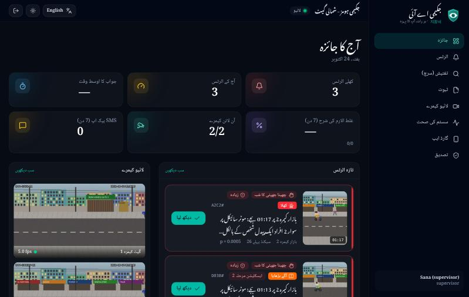
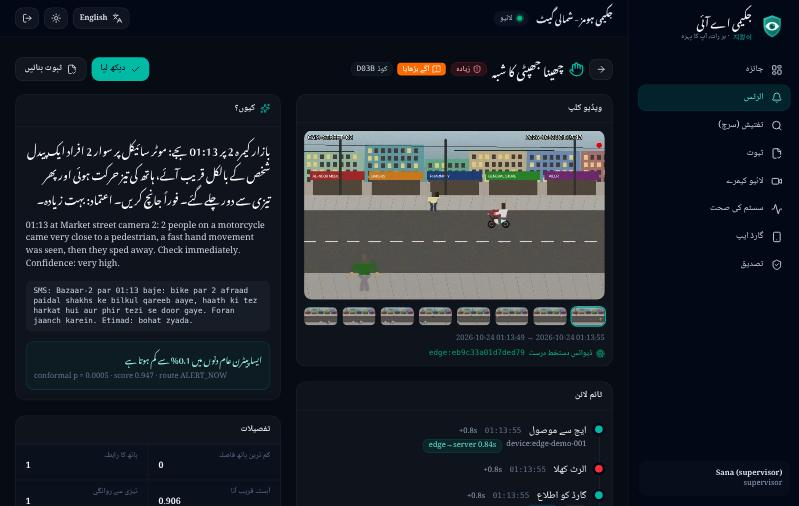
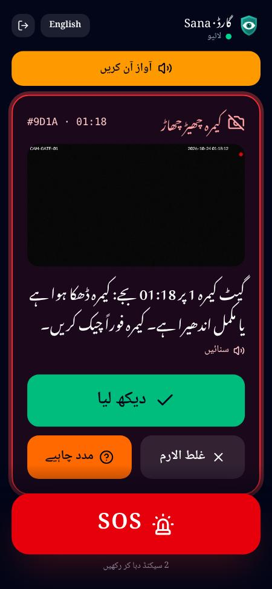
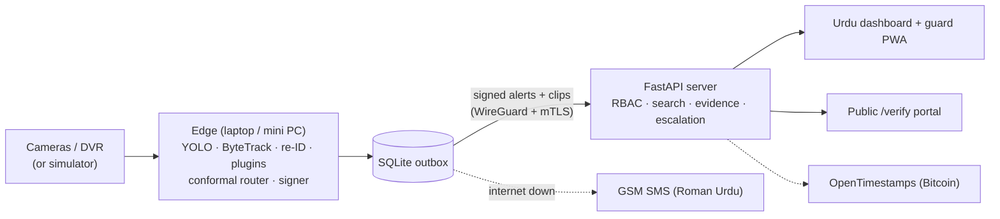

<div align="center">


# Jikimi AI · 지킴이

**Har raat, aapka pehra — the guard that never sleeps.**

Edge-first AI for the CCTV cameras Pakistan already has: it warns **before** a motorcycle snatching,
searches footage in **Roman Urdu**, keeps alerting through **load-shedding by SMS**, and builds
**tamper-evident, FIR-ready evidence** — without face recognition.

    



</div>

> **Status: v0.1 — software MVP, runs end-to-end on a simulator.** Every number below is measured on
> simulated cameras; real-world accuracy needs the consented PakSnatch/PakRoads data and a pilot site
> (see [`docs/PLAN_REVIEW.md`](docs/PLAN_REVIEW.md)).

## Why

- Karachi alone reports tens of thousands of snatched phones a year; Safe City cameras cover main
  roads, not the societies, markets, petrol pumps and shops that run cheap DVRs nobody watches.
- Existing products are English-only, cloud-dependent, built on face recognition (useless under a
  helmet) and do not produce evidence the police can verify.
- Jikimi runs **on the site** (laptop / mini PC), speaks **Urdu**, survives **power and internet cuts**,
  and every alert comes with a plain-Urdu reason and a statistical false-alarm guarantee.

## Try it in two commands

```bash
make setup     # Python (uv) + web (npm) dependencies
make demo      # .env + seed + API + Urdu dashboard + 2 simulated cameras -> http://localhost:8000
```

Log in as `sana` (supervisor), `akram` (guard, open `/guard/` on a phone), `admin` or `police` — the
password is `JIKIMI_DEMO_PASSWORD` in your generated `.env`. Then watch the demo script play out:

| Time | Camera | What happens | What you see |
|---|---|---|---|
| ~1:10 | Gate 1 | the same black bike with 2 riders passes the gate a 2nd time and slows next to a waiting person | **loitering ALERT** before anything happens, Urdu reason, escalation after 60 s |
| ~1:15 | Bazaar 2 | a pillion grabs a pedestrian's phone and the bike speeds away | **snatch ALERT** ~3 s later, blurred clip, evidence button |
| ~2:10 | Bazaar 2 | someone on foot walks up to a person on the phone, grabs it and runs | **snatch ALERT (on foot)** |
| ~3:00 | Bazaar 2 | a rider stops to ask directions | nothing (hard negative) |
| ~3:35 | Bazaar 2 | a walker is followed: the follower stops when they stop and hurries when they hurry | **person in danger · followed** |
| ~4:10 | Gate 1 | a delivery rider hands over a parcel | nothing (hard negative) |
| ~5:00 | Bazaar 2 | a second snatch (new riders, other direction) | **snatch ALERT** |
| ~5:40 | Gate 1 | someone covers the camera | **camera tamper ALERT** |
| ~6:05 | Bazaar 2 | a walker suddenly falls and does not get up | **person in danger · fell down** (high) |

Cut the "internet" with `make net-cut`: high alerts now arrive as Roman Urdu SMS in
`data/edge/sms/outbox.jsonl` (fake GSM modem); reply with `make sms-reply TEXT="1 A7F2"`, then
`make net-restore` and watch everything sync — acks included.

On the **Rules** page (`/rules/`), type a rule in Roman Urdu, e.g. *"raat 11 ke baad gate 2 par koi
5 min se zyada ruke to batao"*: you see what was understood and how often it would have fired last
week; `sana` proposes, `admin` approves, and the edge picks it up signed within a minute. The same
page shows today's **event mode** and the coming Ramadan / Chand Raat / Eid estimates to confirm.

<p align="center">


</p>

## What is in v0.1

| | Feature | |
|---|---|---|
| ✅ | **Early warning (F2)** — loitering bikes: passes, pillion, slow-downs near pedestrians, dwell; anonymous appearance re-ID links re-entries | `edge/.../analytics/loitering` |
| ✅ | **Snatch detection (F3)** — interpretable pose/box baseline + two-person **ST-GCN** (PyTorch training, ONNX on the edge) with license-free synthetic pre-training | `edge/.../snatch`, `ml/` |
| ✅ | **Calibrated alerts (F7)** — split-conformal p-values per site/type/mode, bound to the scorer version; KS drift; empirical FA/camera-hour command | `edge/.../calibration` |
| ✅ | **Offline-first (F4)** — SQLite outbox (survives `kill -9`), SMS fallback in 5 s (GSM modem or fake modem), SMS replies `1 / 2 / 3` | `edge/.../outbox` |
| ✅ | **Urdu reasons (F5)** — Urdu, Roman Urdu (SMS) and English templates + plain-language p-value ("aam dinon mein 0.1% se kam") | `jikimi_common.explain` |
| ✅ | **Roman Urdu search (F1)** — *"kal raat kaali bike 2 sawar gate pe"*: 365-variant lexicon, fuzzy spelling, Urdu script, deterministic time phrases; LLM fallback optional | `server/.../search` |
| ✅ | **Evidence packs (F8)** — two-layer Ed25519 signatures, Urdu/English PDF with QR, RFC 6962 Merkle batches, OpenTimestamps, public verify portal with in-browser file hashing | `server/.../evidence` |
| ✅ | **Escalation (F17), SOS (F22), camera tamper (F10), privacy (F19)** | |
| ✅ | **Dashboard + guard PWA** — Urdu RTL first, dark mode, live WebSocket, offline queue | `apps/dashboard` |
| ✅ | **Rule builder (F11)** — *"raat 11 ke baad gate 2 par koi 5 min se zyada ruke to batao"* → rule; asks instead of guessing, 7-day backtest, admin approval, signed bundle pinned on the edge | `server/.../rules`, `/rules/` |
| ✅ | **Event modes (F16)** — Ramadan, Chand Raat, Eid, Muharram, 14 August, bazaar days: Hijri estimates, admin confirms after moon sighting, each mode has its own calibration set | `server/.../services/calendar.py`, `/rules/` |
| ✅ | **DVR onboarding (F20)** — Urdu setup wizard served by the edge (open it on a phone, PIN): ONVIF discovery or brand + IP, connection test with a blurred preview, draw the zone, detector test, save (password only in `.env`); RTSP templates for Hikvision / Dahua / CP Plus / Uniview / TP-Link | `make setup-wizard`, `discover`, `probe-stream` |
| ✅ | **Voice replies (F12)** — the guard says *"haan dekh liya"* / *"ghalat alarm"* / *"madad chahiye"*; Whisper (int8, CPU) + an Urdu / Roman / Hindi intent parser; sent only after the guard's tap; audio never stored | guard PWA, `/v1/voice/reply` |
| ✅ | **Camera re-anchor (F10)** — a camera turned on purpose: admin "accept new view" (signed edge command) or automatic after 10 min | `/health/` |
| ✅ | **Alerts read aloud (F12)** — Urdu voice when the phone has one, else its Hindi voice reads the alert written in Devanagari (spoken Urdu and Hindi are one language) | guard PWA |
| ✅ | **Investigation agent (F1)** — "kal raat kaali bike 2 sawar … ye bike aur kahan gayi … report banao": read-only tools, every answer cites clips, 48/48 scripted tasks | Analyst → تفتیش |
| ✅ | **Cross-camera routes (F2)** — a bike circling gate ↔ street is linked across cameras and scored as one route (calibrated per route) | `edge/.../cross_camera.py` |
| ✅ | **Risk estimate + patrol (F15)**, **mohalla network (F21, opt-in, embeddings only, 2 h)**, **audio events (F13)**, **federated learning (F14)** | overview card, rules page, `ml/` |
| ✅ | **Personal safety (F23)** — a phone snatched by someone on foot; *before an assault*: someone followed, surrounded, a struggle, dragged, pushed into a car, a sudden fall; a parked bike worked on and taken; a crowd running in panic. Behaviour only — no gender, age or identity is ever estimated (ADR-0034) | `edge/.../analytics/{foot_snatch,person_safety,vehicle_theft,crowd}` |
| 🟡 | VLM verifier + distillation (F5/F6): built and measured, but the laptop-size VLM fails its own test and stays silent; low-light enhancement (F18) built and off (no measured gain) | [results](docs/results.md#tier-2-and-tier-3-features-v24) |
| ⏳ | Everything that needs real data: pilot footage, guard recordings, PakSnatch / PakRoads | [roadmap](docs/PLAN_REVIEW.md#3-kya-bana-v01--feature-status) |

## Architecture



More: [architecture](docs/architecture/overview.md) · [threat model](docs/architecture/threat_model.md) · [33 ADRs](docs/adr/).

## Measured so far (simulator, plus one real clip)

| What | Result |
|---|---|
| Golden replay suite (7 scenario types, 18 runs, 8 of them hard negatives) | **18/18 pass** |
| Snatch alert latency (event → ALERT_NOW), day and night | ~3.4 s |
| Loitering warning | at the 2nd pass with a slow-down, ~45 s after the first pass |
| Edge → server alert latency (laptop) | ~1 s |
| Internet down → SMS | 5.0 s in the live demo (plan target < 20 s); SMS reply synced as the ack |
| Power cut (`kill -9` mid-write) | 0 committed alerts lost |
| Roman Urdu query parse + search | ~15 ms |
| Roman Urdu search end to end (RUVR-sim: pixels → colour/riders → index → query, 61 queries, 2–3 spellings each) | Recall@10 0.85, MRR 1.00 |
| Conformal p-values on held-out units | valid: P(p ≤ α) ≤ α at α = 0.01 … 0.2 |
| Server tests on PostgreSQL 16 + pgvector | 81/81 |
| False alarms, held-out simulated normal traffic | **0 in 30 camera-hours** (95 % bound 0.0999 < plan's 0.1 / h) |
| Snatch ST-GCN, synthetic held-out episodes | test AUC 0.978 [0.966, 0.989] |
| Real footage (crowded junction clip, filmed from a car) | 3 snatch false alarms found → **0** after the fixes they led to; bike colours from all-"black" to ~7 of 11 clearly right |
| Edge throughput on the i5-6200U | simulator 51.7 frames/s; real video ≈ 0.9 camera at 5 fps with FP32 ONNX, **1.3** with OpenVINO INT8 (quantized on local frames, recall 0.96 vs FP32) |
| Guard voice replies (written test set, first run) | 93.1 % intent; noise / silence → no intent; ~5 s per reply on the laptop CPU |
| Cross-camera scouts (synthetic routes) | 85 % flagged by the 3rd segment, 97 % by the 4th; normal routes 0.62 % at α = 1 % |
| Investigation agent (48 scripted multi-turn tasks) | 48/48, one tool call per turn, every answer cites clips |

Every number, how it was measured and how to reproduce it: [`docs/results.md`](docs/results.md).

## Repository

```
packages/   contracts (Pydantic → TypeScript) · common · crypto · ml-runtime (OpenVINO/ONNX, torch-free)
edge/       edge runtime, plugins, simulator, outbox/SMS          (python -m jikimi_edge)
server/     FastAPI API, search, evidence, escalation, workers     (python -m jikimi_server)
apps/       Next.js dashboard + guard PWA (static export served by the API)
ml/         ST-GCN, trajectory transformer, PakSnatch-sim, training, statistics
eval/       golden replay, chaos tests, load benchmark
datasets/   datasheets, annotation guide, consent forms (Urdu/English), RUVR lexicon
deploy/     docker compose profiles, Dockerfiles, MediaMTX, systemd, fake cameras
docs/       plan v2.4, plan review (44 issues), ADRs, architecture, runbooks, Urdu user guides
```

## Development

```bash
make test          # unit + API + contract tests, TypeScript check, dashboard tests
make replay        # golden scenarios (slow)
make lint          # ruff, mypy --strict (shared packages), tsc
make evaluate-fa   # false alarms per camera-hour on held-out simulated traffic
make web-dev       # dashboard with hot reload on :3000
make help          # everything else
```

Evaluations behind [`docs/results.md`](docs/results.md):

```bash
uv run python -m eval.ruvr_sim --scenes 4                        # Roman Urdu search: Recall@10, MRR
uv run python -m eval.shadow_snatch                               # B1 heuristic vs ST-GCN, same pairs
uv run python -m eval.voice_check --tts                           # guard voice replies: intents + Whisper
uv run python scripts/quantize_openvino.py                        # ONNX -> OpenVINO INT8 (+ FP32 comparison)
uv run python -m jikimi_ml.eval.evaluate_stgcn --model models/stgcn_paksnatch_sim.onnx --data data/ml/paksnatch_sim.npz
```

Real cameras: copy `edge/config/site.example.yaml` to `edge/config/site.yaml`, run
`make setup-wizard EDGE_CFG=edge/config/site.yaml` and open the printed address on a phone on the
same network (or use `discover` / `probe-stream` on the command line), export models
(`scripts/quantize_openvino.py` or `scripts/download_models.py`), then follow
[`docs/runbooks/pilot_setup.md`](docs/runbooks/pilot_setup.md).

## Privacy and responsible use

No face recognition (blocked in the plugin registry) · heads/faces blurred in every stored image ·
unblurred originals encrypted on the edge · neutral alert language ("mashkook harkat", never
"chor") · humans decide, the system only advises · every view/export is in a hash-chained audit log.
Read [`docs/user-guides/`](docs/user-guides/) (Urdu) and `SECURITY.md`.

## Project documents

- [`docs/IMPLEMENTATION_PLAN.md`](docs/IMPLEMENTATION_PLAN.md) — the full plan (v2.4)
- [`docs/PLAN_REVIEW.md`](docs/PLAN_REVIEW.md) — analysis: 31 plan issues + 13 found while testing (6 on real video), all fixed; feature status, next steps
- [`docs/results.md`](docs/results.md) — measured numbers and how to reproduce them

## License

Code: Apache-2.0 (`LICENSE`). Datasets: CC BY-NC 4.0 (`DATA_LICENSE.md`) — confirm with your
supervisor/university before the first public release.
# Jikimi-Ai
