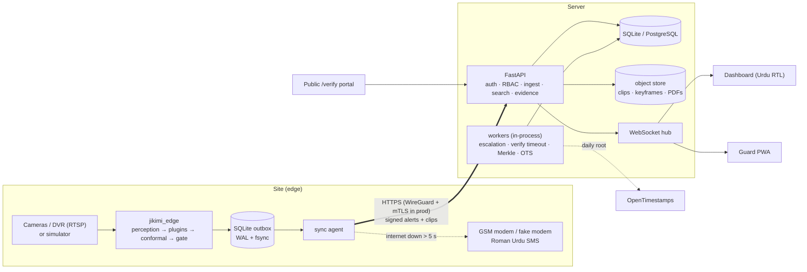
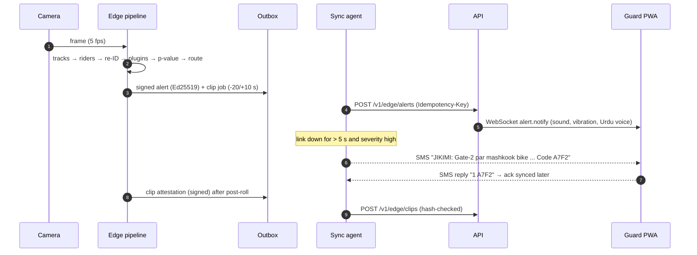

# Architecture (as built in v0.1)

C4 views follow plan Section 7; this page shows what is implemented and where.

## Containers



## Alert path (S1/S2 in the plan)



## Rule and calendar path (F11, F16; ADR-0022, ADR-0023)

```mermaid
sequenceDiagram
  autonumber
  participant SV as Supervisor
  participant A as API
  participant AD as Admin
  participant S as Edge sync agent
  participant E as Rules plugin
  SV->>A: POST /v1/rules/draft "raat 11 ke baad gate 2 par koi 5 min se zyada ruke"
  A-->>SV: rule (or questions) + 7-day backtest
  SV->>A: POST /v1/rules (pending, audit)
  AD->>A: POST /v1/rules/{id}/approve (audit)
  S->>A: GET /v1/edge/rules (every 60 s while online)
  A-->>S: bundle of active rules, signed by the server key
  S->>S: verify signature, pinned key, site, approved_by; store bundle
  S->>E: hot reload between two frames
  Note over S,E: same for GET /v1/edge/calendar: confirmed event-mode windows → mode of the day → calibration set
```

## Where things live

| Concern | Code |
|---|---|
| Contracts | `packages/jikimi-contracts` (+ generated `apps/dashboard/src/lib/contracts.gen.ts`) |
| Crypto (SHA-256, Ed25519, RFC 6962 Merkle, JCS canonical JSON, OTS) | `packages/jikimi-crypto` |
| Inference backends + YOLO decode | `packages/jikimi-ml-runtime` |
| Edge plugins | `edge/src/jikimi_edge/analytics/{loitering,snatch,camera_health,rules}` |
| Conformal + drift | `edge/src/jikimi_edge/calibration` |
| Outbox, SMS, sync | `edge/src/jikimi_edge/outbox` |
| Simulator | `edge/src/jikimi_edge/sim` |
| Alert lifecycle, escalation | `server/src/jikimi_server/services` |
| Roman Urdu search | `server/src/jikimi_server/search` |
| Rule builder (parser, backtest, bundle) | `server/src/jikimi_server/rules`, edge side `edge/src/jikimi_edge/analytics/rules` |
| Evidence packs + verification | `server/src/jikimi_server/evidence` |
| ML models + stats | `ml/src/jikimi_ml` |
| Golden replay, chaos, load | `eval/` |
